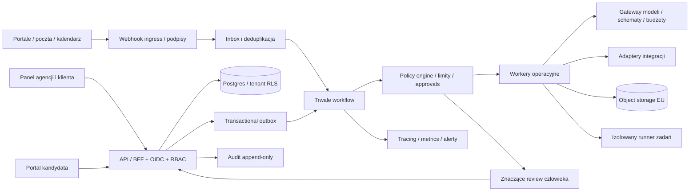

# HireOS — system design / ADR 001

## Architektura docelowa

Modularny monolit API z wydzielonymi workerami i trwałym workflow. Mikroserwisy dopiero po zmierzeniu potrzeby izolacji i skali. Prototyp Node/SQLite nie realizuje poniższej architektury produkcyjnej.

## Technologia i odpowiedzialności

Frontend docelowo TypeScript/React; panel i portal kandydata rozdzielone uprawnieniami. API Node/TypeScript. PostgreSQL jako źródło prawdy z RLS, migracjami i szyfrowaniem kopii. S3-compatible object storage w regionie UE dla dokumentów, skanowanie przed parserem i podpisane krótkotrwałe URL. Temporal jako trwały silnik workflow (alternatywy wymagają ADR); Redis wyłącznie cache/rate limits, nigdy jedyne źródło stanu. OIDC/SSO przez dostawcę tożsamości, MFA dla operatorów. OpenTelemetry, metryki bez PII, alerty per connector i tenant.

## Model domenowy

Każda tabela biznesowa ma tenant_id, id, created_at, updated_at i wersję do optimistic locking. Klucze obce obejmują tenant_id, aby zapobiec połączeniom między klientami.

| Encja                           | Dane i reguły                                                            |
| ------------------------------- | ------------------------------------------------------------------------ |
| Tenant / Client / Membership    | Podmiot agencji, klienci, użytkownicy, role i zakres klienta             |
| Requisition / CriteriaVersion   | Wymagania, lokalizacja, stawka, branch playbook, zatwierdzona wersja     |
| Candidate / Application         | Tożsamość odrębna od aplikacji; proces i zgody/informacje per cel        |
| SourceRecord / LegalBasisRecord | Pochodzenie, czas, zakres licencji, cel, podstawa i retencja             |
| Document / Evidence             | Hash pliku, wynik skanowania, cytat, strona, kryterium, stan weryfikacji |
| Interview / Assessment          | Termin, scenariusz, dostosowania, wyniki testów i materiały źródłowe     |
| Review / Decision               | Uprawniony człowiek, uzasadnienie, wersja materiałów, wynik i odwołanie  |
| WorkflowRun / Task / Approval   | Maszyna stanów, retry, lease, deadline, budżet, wersja polityki          |
| Connector / OAuthGrant          | Dostawca, scope, secret reference, health, expiration                    |
| InboxEvent / OutboxEvent        | Provider event id, tenant, hash, dedup key, delivery state               |
| AuditEvent / UsageLedger        | Actor, operation, object, before/after hash, trace, model/tokens/cost    |

Deduplikacja kandydata tylko wewnątrz uprawnionego tenant scope; podobieństwo imion nie powoduje automatycznego scalenia. Przy zatrudnieniu, odmowie i udostępnieniu danych polityka wymaga zatwierdzenia człowieka. Workflow nie kończy aplikacji wyłącznie z powodu timeoutu lub braku odpowiedzi; wysyła do kolejki wyjątków.

## Kontrakty i przepływy

Docelowe endpointy: POST /v1/requisitions, POST /v1/applications, GET /v1/applications/:id/evidence, POST /v1/interviews, POST /v1/reviews, POST /v1/decisions/:id/approve, POST /v1/connectors/:provider/webhooks, POST /v1/privacy/requests. Wszystkie wymagają tenant scope z tożsamości serwera, nie z zaufania do przesłanego tenant_id. Mutacje przyjmują Idempotency-Key oraz expectedVersion. API zwraca requestId i ustrukturyzowany błąd bez PII.

Zdarzenie: {eventId, tenantId, type, schemaVersion, occurredAt, aggregateId, aggregateVersion, correlationId, payloadRef}. Payload z PII przechowywany za kontrolą dostępu, nie kopiowany do logów. Kafka nie jest wymagana na etapie MVP.

1. Podpisany webhook trafia do inbox; unikalny (tenant, provider, eventId) blokuje replay.
2. Transakcja zapisuje aplikację i outbox. Przy braku podpisów stosujemy udokumentowany mechanizm autoryzacji dostawcy, a nie „best effort”.
3. Workflow skanuje plik, parsuje, waliduje JSON i zapisuje dowody. Awaria dostawcy nie gubi aplikacji.
4. Policy engine sprawdza cel, uprawnienia, stan, budżet, kontakt opt-out i zgodność operacji z zatwierdzonym playbookiem.
5. Każda operacja zewnętrzna ma idempotency key lub reconciliation po identyfikatorze. Nie obiecujemy dokładnie-jednokrotnej wysyłki, jeśli dostawca tego nie obsługuje; stany niepewne trafiają do operatora bez ślepego retry.
6. Retry z jitter i Retry-After; błędy 4xx trwałe bez retry, 401 odświeżenie raz, 429/5xx ograniczone retry. Dead-letter queue po limicie prób i alarm SLA.

## Agenci i polityki modeli

Astra 6 jest nadzorcą implementacji w T3. W produkcie nadzorca procesu to stanowy workflow + policy engine; model nie jest jedynym arbitrem ani trwałą bazą danych. Konkretne modele produkcyjne wybieramy po benchmarkach, dostępności API, warunkach retencji i rezydencji, a nie na podstawie dostępności w T3.

- Brief Assistant: proponuje ustrukturyzowany brief; człowiek zatwierdza wymagania.
- Sourcing Assistant: przygotowuje zapytania/ogłoszenia, nie obchodzi ograniczeń portali.
- Evidence Assistant: cytaty i mapowanie do kryteriów, bez decyzji o osobie.
- Scheduling Agent: operacje kalendarza w uprawnionym zakresie.
- Interview Assistant: zatwierdzone pytania, materiały i transkrypcja; opcja kontaktu z człowiekiem.
- Communications Agent: zatwierdzone szablony, limity, opt-out, brak autonomicznej odmowy.
- Operations Agent: backlog, SLA, koszty i eskalacje bez dostępu do pełnych CV.

Każde wywołanie: schema validation, ograniczenie wejścia/wyjścia, timeout, limit kosztu, wersja promptu/modelu, trace oraz evidence references. Dokumenty i transkrypcje są niezaufanym wejściem. Brak dostępu modeli do sekretów. Tool allowlist i zakresy wydaje policy engine, nie instrukcja z CV. Zmiana modelu wymaga ponownego eval.

## Security, prywatność i operacje

Izolacja tenantów w DB, API, obiektach, cache i indeksach wyszukiwania. Role: admin agencji, recruiter, hiring manager ograniczony do klienta/rekrutacji, auditor, candidate self-access. Dostęp wsparcia czasowy i audytowany. Klucze integracji w secret manager, rotacja i scope minimalny. Zgody na kontakt talent-pool odrębne od procesu aplikacji.

Retencja konfigurowana według celu i podstawy: aktywna rekrutacja, zakończona sprawa, talent pool, nagrania, logi. Usuwanie obejmuje dokumenty, indeksy, cache i dostawców; kopie wygasają według harmonogramu i po restore wykonuje się ponownie tombstones. Legal hold ma uzasadnienie, zakres i termin, nie jest domyślnym wyjątkiem.

Sandbox zadań: efemeryczny VM/container z twardymi limitami CPU/RAM/czasu, bez sekretów hosta, bez sieci domyślnie, read-only template, wyjście skanowane, pełny cleanup. Nie uruchamiać kodu kandydatów w workerze API.

Testy produkcyjne: cross-tenant authorization, replay webhooków, crash między commit a publish, timeout niepewnej wysyłki, kalendarz DST, usunięcie danych i restore, prompt injection, złośliwy PDF, sandbox escape controls, ograniczenia kosztu, fallback do człowieka, keyboard/screen-reader, obciążenie i awarie dostawcy.

## Integracje i zależności zewnętrzne

W pierwszym pionowym przepływie: własny formularz + jeden dostawca poczty + jeden kalendarz + jeden kanał publikacji. LinkedIn wymaga zatwierdzonego dostępu partnerskiego; nie planujemy scrapingu ani automatyzacji kont wbrew zasadom. Dla Pracuj.pl, OLX Praca, Indeed, JJIT, NFJ dostępność API/feed, scope i umowy należy potwierdzić z dostawcą. Brak publicznego API oznacza integrację umowną, import dostarczony zgodnie z uprawnieniami albo ręczny krok, nie obchodzenie ograniczeń.

Rozmowy: najpierw linki Meet/Teams i szablony; później LiveKit dla własnego doświadczenia audio, po decyzji o zgodach i retencji. ATS/HRIS: jeden adapter pilota (np. Greenhouse/Lever/Personio), po potwierdzeniu konta klienta. Podpis: DocuSign/Autenti, wyłącznie po zatwierdzeniu dokumentów. SMS: dostawca regionalny lub Twilio, dopiero z legalnym kanałem kontaktu i opt-out. Linear to system realizacji produktu, nie magazyn CV.
